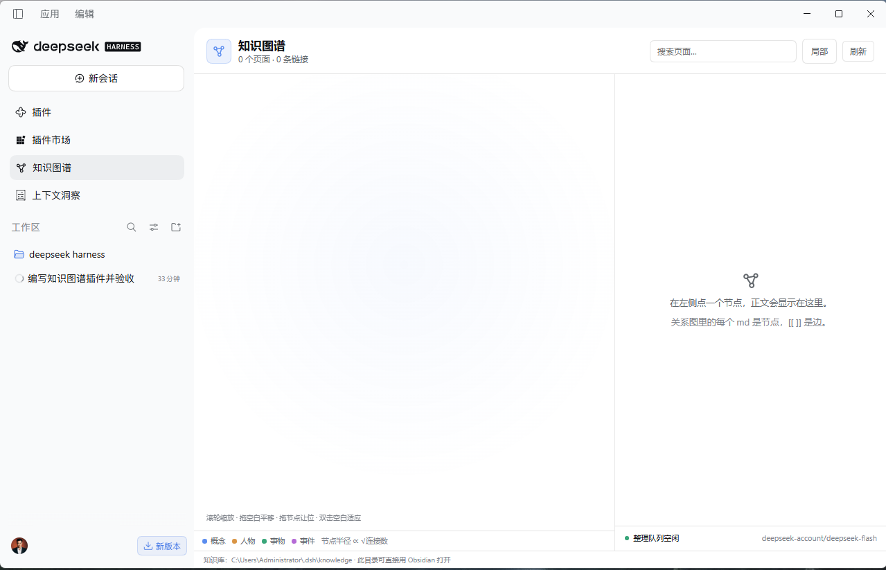
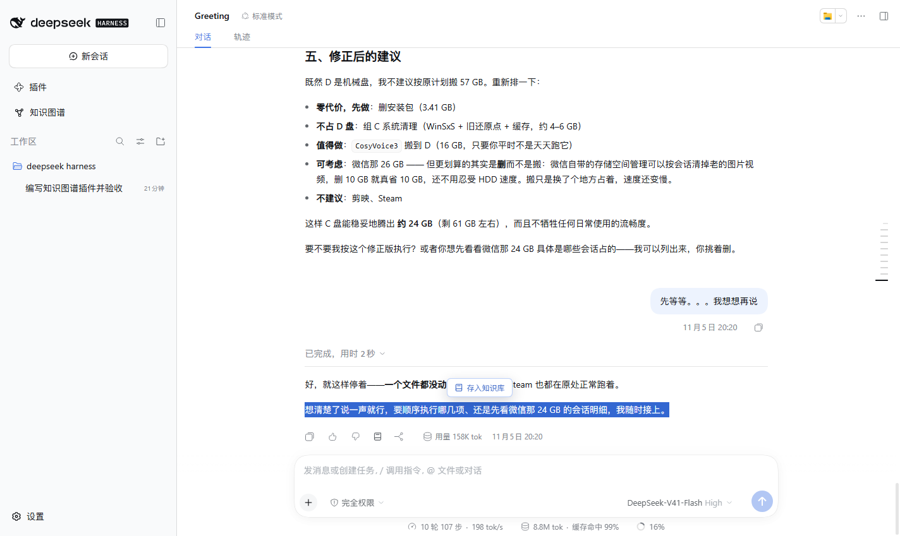
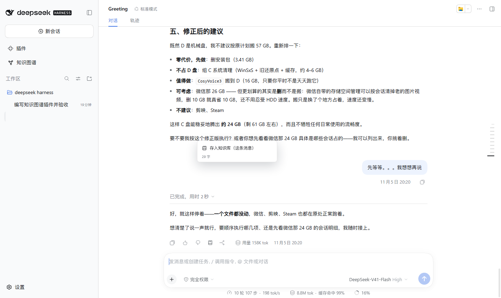
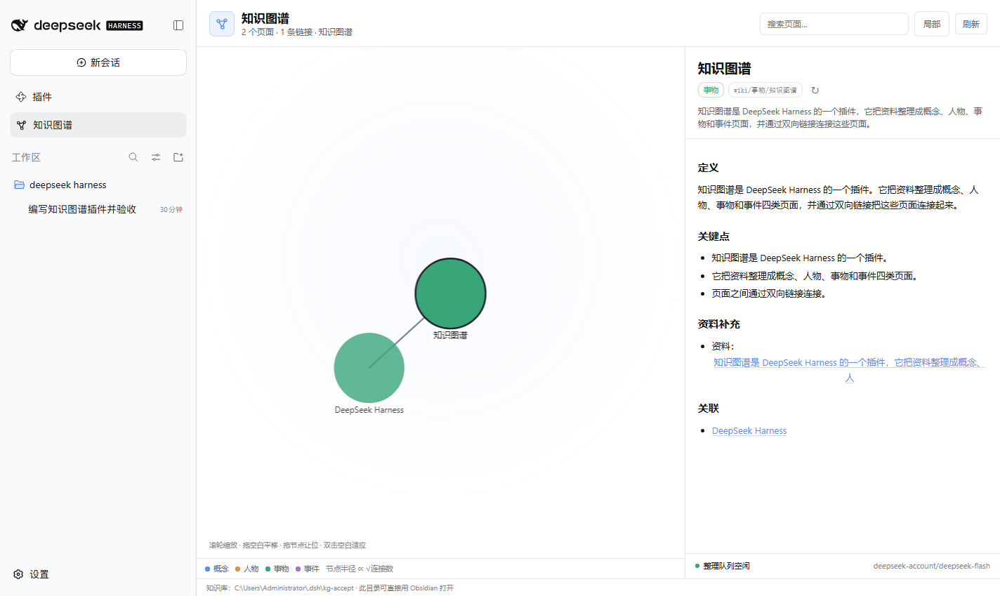
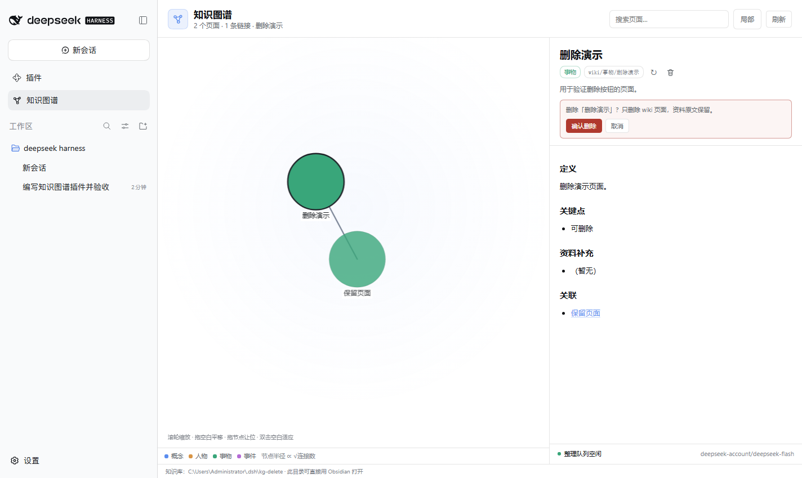
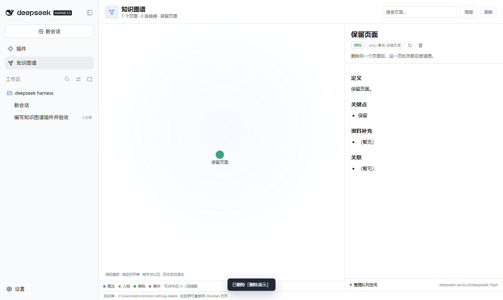

# 鐭ヨ瘑鍥捐氨锛坉sh-knowledge-graph锛?
[](https://github.com/3722593qq/dsh-knowledge-graph/actions/workflows/ci.yml)
[](https://github.com/3722593qq/dsh-knowledge-graph/releases)
[](LICENSE)

缁?DeepSeek Harness 鐢ㄧ殑鏈湴鐭ヨ瘑搴?+ Obsidian 椋庢牸 wiki + 鍔涘鍚戝叧绯诲浘銆?


涓婂浘鏄綋鍓?DSH Desktop 閲岀殑瀹為檯椤甸潰锛堢煡璇嗗簱涓虹┖鏃讹級銆?
## 瀹冨仛浠€涔?
- 閫変腑鏂囧瓧鍚庡嚭鐜般€屽瓨鍏ョ煡璇嗗簱銆嶆诞鍔ㄦ寜閽紱鍙抽敭鑿滃崟涔熻兘瀛樸€?- 姣忔潯 AI 鍥炵瓟涓嬫柟鏈変功褰㈠浘鏍囷紝涓€娆″瓨鏁存潯鍥炵瓟銆?- 鍦ㄣ€屾垜鍙戠殑娑堟伅銆嶄笂鍙抽敭锛屽彲鐩存帴瀛樿繖鏉℃秷鎭€?- 淇濆瓨涓嶅脊绐楋細绔嬪埢鍦?`璧勬枡/` 鍐欎竴鏉″彧璇诲師濮嬬瑪璁帮紝骞剁珛鍒诲垱寤轰竴涓?wiki 鑽夌椤碉紝闅忓悗鍦ㄥ悗鍙扮敤褰撳墠妯″瀷鎶婂畠鏁寸悊鎴愭蹇?/ 浜虹墿 / 浜嬬墿 / 浜嬩欢椤甸潰銆?- 鏁寸悊闃熷垪涓ユ牸涓茶锛涘け璐ヤ細鍐欒繘 `log.md` 鍜岄潰鏉跨殑銆屾渶杩戠粨鏋溿€嶏紝涓嶄細闃诲涓嬩竴鏉°€?- 宸︿晶鏍忋€岀煡璇嗗浘璋便€嶉〉闈細宸﹁竟鍏崇郴鍥撅紙Markdown 鏂囦欢鏄妭鐐癸紝`[[ ]]` 鏄竟锛夛紝鍙宠竟姝ｆ枃銆?- 鍙充晶姝ｆ枃鏍囬鏍忔湁鍒犻櫎鎸夐挳锛氫簩娆＄‘璁ゅ悗鍒犻櫎褰撳墠 wiki 椤甸潰锛屽苟娓呯悊鍏朵粬椤甸潰鎸囧悜瀹冪殑鍏宠仈锛沗璧勬枡/` 鍘熸枃淇濈暀銆?- Agent 鍙嬁鍒板洓涓彧璇诲伐鍏凤紱鍏ㄥ眬瑙勫垯瑕佹眰鍏堣绱㈠紩锛屽啀璇荤浉鍏抽〉锛屽苟鍦ㄥ洖绛旀湯灏炬爣娉ㄧ煡璇嗘潵婧愩€?




## 鐭ヨ瘑搴撲綅缃?
榛樿鍦?DSH 鏁版嵁鐩綍锛?
```text
~/.dsh/knowledge/
鈹溾攢鈹€ 璧勬枡/                 # 淇濆瓨鍚庝笉鍐嶄慨鏀圭殑鍘熷绗旇
鈹溾攢鈹€ wiki/
鈹?  鈹溾攢鈹€ 姒傚康/
鈹?  鈹溾攢鈹€ 浜虹墿/
鈹?  鈹溾攢鈹€ 浜嬬墿/
鈹?  鈹斺攢鈹€ 浜嬩欢/
鈹溾攢鈹€ index.md              # 姣忔淇濆瓨/鏁寸悊鍚庡叏閲忛噸鍐?鈹斺攢鈹€ log.md                # 姣忔鏁寸悊杩藉姞涓€琛?```

Windows 涓嬮€氬父鏄?`C:\Users\<浣?\.dsh\knowledge`銆傜敤 Obsidian 鐩存帴鎵撳紑杩欎釜鐩綍鍗冲彲锛涢〉闈㈠唴鐨勯摼鎺ュ舰濡?`[[wiki/姒傚康/椤甸潰]]`銆?
閰嶇疆 `rootDir` 鍙互鏀瑰埌鍒殑鐩綍锛?
```yaml
- id: knowledge-graph
  name: dsh-knowledge-graph
  config:
    rootDir: D:/notes/knowledge   # 缁濆璺緞锛屾垨鐩稿 $DSH_HOME 鐨勮矾寰?```

涔熸敮鎸佹祴璇曠敤鐜鍙橀噺 `DSH_KNOWLEDGE_DIR`銆傛ā鍨嬮粯璁よ窡闅?`agentDefaultModel.currentSelection()`锛屽彲鐢?`provider` / `model` 瑕嗙洊锛沗maxTokens` 榛樿 4000銆?
## 椤甸潰鏍煎紡

```markdown
---
title: "椤甸潰鏍囬"
category: "姒傚康"
summary: "涓€鍙ヨ瘽鎽樿"
updated: "2026-11-06 17:42"
---
# 椤甸潰鏍囬

## 瀹氫箟
...
## 鍏抽敭鐐?- ...
## 璧勬枡琛ュ厖
- 璧勬枡锛歔[璧勬枡/鍘熷绗旇]]
## 鍏宠仈
- [[wiki/浜嬬墿/鍙︿竴涓〉闈]

## 鐭涚浘涓庝笉鍚岃娉?浠呭綋璧勬枡涓庡凡鏈夐〉闈?璧勬枡鍐呴儴瀛樺湪鍐茬獊鏃跺嚭鐜般€?```

瀹夸富浼氬湪鍐欏叆鍚庤ˉ榻愬弽鍚戦摼鎺ワ細A 鐨勩€屽叧鑱斻€嶅嚭鐜?B锛孊 鐨勩€屽叧鑱斻€嶄篃浼氬嚭鐜?A銆俙index.md` 姣忔鍏ㄩ噺閲嶅缓锛沗log.md` 姣忔鍙拷鍔狅紝涓嶉噸鍐欏巻鍙层€?
## 宸︿晶鏍忛〉闈?


- 鑺傜偣鍗婂緞鎸夎繛鎺ユ暟寮€鏂规槧灏勫埌 4.8鈥?0.8px銆?- 鍔涘鍚戦€愬抚璁＄畻锛氭枼鍔?650銆佸脊绨?0.28銆佸悜蹇?0.0011銆佺鎾為棿闅?6px銆佹懇鎿?0.85锛沘lpha 姣忓抚涔?0.985锛岄檷鍒?0.01 鍋滄銆?- 鏈€変腑鏃惰竟閫忔槑搴?0.3锛涢€変腑/鎮仠鏃堕偦灞呬寒搴?0.8銆佺浜屽眰 0.35銆佹洿杩?0.12锛屾棤鍏宠竟 0.06銆?- 鏍囩鍥哄畾 12px锛屽湪缂╂斁 0.5鈥?.8 涔嬮棿娓愭樉锛屾寜浼樺厛绾у仛鐭╁舰纰版挒閬胯銆?- 婊氳疆浠ュ厜鏍囦负涓績缂╂斁锛涙嫋绌虹櫧鍙敼瑙嗗浘锛涙嫋鑺傜偣浼氶噸鍚姩鐢诲苟璁╁懆鍥磋妭鐐归€氳繃纰版挒璁╀綅锛屾澗鎵嬪悗妯℃嫙鍒板仠銆?- 鍙屽嚮绌虹櫧閫傚簲绐楀彛锛涙悳绱細楂樹寒鍛戒腑鍜岄偦灞呫€?- 銆屽眬閮ㄣ€嶉粯璁ゆ樉绀哄綋鍓嶉〉鍛ㄥ洿 2 灞傦紝鍙皟 1鈥? 灞傘€?- 鏁版嵁鏇存柊娌跨敤鍚屼竴涓ā鎷燂細宸叉湁鑺傜偣鍧愭爣鍜屽綋鍓嶈鍥句繚鐣欙紝涓嶉噸缃€?
## 鍒犻櫎椤甸潰

姝ｆ枃鏍囬鍙充晶鐨勫瀮鍦炬《鎸夐挳浼氬厛灞曞紑浜屾纭锛?


纭鍚庯細

- 鍒犻櫎瀵瑰簲鐨?`wiki/<鍒嗙被>/<椤甸潰>.md`銆?- 鎵弿鍏朵粬椤甸潰锛屼粠銆屽叧鑱斻€嶇Щ闄ゆ寚鍚戣椤电殑閾炬帴锛屽苟鎶婃鏂囬噷鐨勬畫鐣?`[[...]]` 鏇挎崲鎴愭枃瀛椼€?- 鍏ㄩ噺閲嶅缓 `index.md`锛屽悜 `log.md` 杩藉姞鍒犻櫎璁板綍銆?- 鍏崇郴鍥剧珛鍗冲埛鏂帮紱濡傛灉杩樻湁椤甸潰锛屼細鑷姩閫変腑褰撳墠杩炴帴鏈€澶氱殑椤甸潰銆?- `璧勬枡/` 閲岀殑鍘熷绗旇涓嶅垹闄わ紙鍘熷璧勬枡鏄笉鍙彉杈撳叆锛夈€?- 鏁寸悊闃熷垪姝ｅ湪杩愯鏃舵嫆缁濆垹闄わ紝閬垮厤鍚庡彴鏁寸悊鎶婇〉闈㈤噸鏂板啓鍥炴潵銆?


### 鍒犻櫎鎶?HTTP 405

405 琛ㄧず娴忚鍣ㄥ凡缁忓姞杞戒簡 0.1.1 鐨勫垹闄ゆ寜閽紝浣嗘鍦ㄨ繍琛岀殑 **host 浠嶆槸 0.1.0**锛屾病鏈夋敞鍐?`POST /knowledge-graph/api/delete` 璺敱锛汥SH Web Server 瀵规湭鐭?POST 璺緞杩斿洖 405銆備粎鍒锋柊椤甸潰鎴栧彧閲嶈浇 client bundle 涓嶅锛岄渶瑕?*瀹屽叏閫€鍑?DeepSeek Harness 鍐嶉噸鏂板惎鍔?*锛堜笉鏄叧闂獥鍙ｅ埌鎵樼洏锛夛紝璁╁涓婚噸鏂板姞杞?`lib/index.js`銆傞噸鍚悗鍒犻櫎璇锋眰浼氬緱鍒?200锛涜矾鐢变笉瀛樺湪鏃舵墠浼氬緱鍒?405銆?
## Agent 鍙宸ュ叿

| 宸ュ叿 | 浣滅敤 |
| --- | --- |
| `knowledge_index` | 璇诲彇 `index.md` |
| `knowledge_read` | 璇诲彇涓€椤?wiki 鎴栫储寮?|
| `knowledge_search` | 鎼滅储鏍囬銆佹憳瑕併€佹鏂?|
| `knowledge_graph` | 璇诲彇灞€閮ㄥ叧绯诲浘 |

娌℃湁浠讳綍鍐欑煡璇嗗簱鐨?Agent 宸ュ叿锛涘啓鍏ュ彧鏉ヨ嚜鐣岄潰鎿嶄綔銆?
鍏ㄥ眬瑙勫垯浼氳姹傛ā鍨嬶細闂鍙兘鐩稿叧鏃跺厛 `knowledge_index`锛屽啀 `knowledge_read` 鐩稿叧椤碉紱鍥炵瓟鏈熬鍐?`鐭ヨ瘑鏉ユ簮锛歔[wiki/...]]`銆?
## 瀹夎

瑕佹眰锛欴SH `>= 0.2.0-rc.2`锛孨ode `^22.19.0 || >=24.0.0`銆傛彃浠舵病鏈夋瀯寤烘楠わ紝浠撳簱閲岀洿鎺ュ寘鍚彲鍔犺浇鐨?`lib/*.js`銆?
### 浠?GitHub 瀹夎锛堟帹鑽愶級

```powershell
dsh plugin --profile <profile> add github:3722593qq/dsh-knowledge-graph
```

### 浠?Release tarball 瀹夎

```powershell
dsh plugin --profile <profile> add https://github.com/3722593qq/dsh-knowledge-graph/releases/download/v0.1.2/dsh-knowledge-graph-0.1.2.tgz
```

### 鏈湴寮€鍙?
```powershell
git clone https://github.com/3722593qq/dsh-knowledge-graph.git
dsh plugin --profile <profile> add ./dsh-knowledge-graph
```

瀹夎鍚庡鏋滃涓绘病鏈夌珛鍗虫樉绀哄乏渚ф爮銆岀煡璇嗗浘璋便€嶏紝**瀹屽叏閫€鍑哄苟閲嶆柊鍚姩 DeepSeek Harness**锛堜笉鏄彧鍒锋柊椤甸潰锛夈€?.1.1 鏂板鐨勫垹闄ゆ帴鍙ｆ槸瀹夸富璺敱锛屽埛鏂板彧浼氭洿鏂版祻瑙堝櫒 bundle锛屾棫瀹夸富浼氳繑鍥?HTTP 405銆?
### 鍙戝竷

```powershell
npm test
npm pack
git tag v0.1.2
git push origin main --tags
```

鎺ㄩ€?`v*` tag 浼氳Е鍙?`.github/workflows/release.yml`锛岃嚜鍔ㄥ垱寤?GitHub Release 骞堕檮甯?`.tgz`銆?
## 鑷獙

`docs/acceptance.json` 璁板綍浜嗗湪鏈満 DSH 0.2.0-rc.2 + `deepseek-account/deepseek-flash` 涓婄殑瀹炴祴缁撴灉锛?
| 楠屾敹椤?| 缁撴灉 |
| --- | --- |
| 瀛樹竴鏉?25 绉掑唴 wiki 鏈夊彉鍖?| API 12鈥?3ms 杩斿洖鏃惰崏绋块〉宸茶惤鐩橈紱鍚ā鍨嬫暣鐞嗗埌绌洪棽 2.1鈥?.1s |
| 閾炬帴鍙屽悜 | 涓や釜椤甸潰浜掔浉鍑虹幇鍦?`鍏宠仈`锛屽浘璋辫竟 `weight=2` |
| 杩炴帴鏈€澶氱殑鍦ㄤ腑闂?| 鏈€楂樿繛鎺ヨ妭鐐瑰潗鏍囩害 `(0, 0)`锛岃鍥句互瀹冧负涓績 |
| 鎷栬妭鐐瑰懆鍥磋浣?| 鎷栨嫿涓偦灞呯Щ鍔?79.8px锛沘lpha 淇濇寔銆乺unning=true锛涙澗鎵嬪悗 alpha 0.00995銆乺unning=false |
| 鍚庡彴鏁寸悊涓嶉噸鎺?| 鏂版暟鎹埌鏉ユ椂澶嶇敤鏃у潗鏍囦笌 transform锛沘lpha 浠呬粠 0.00995 鎶埌 0.85 |
| 300 涓妭鐐逛笉鍗?| 304 鑺傜偣 / 601 杈癸紝120 甯у钩鍧?16.44ms銆乸95 16.8ms銆佹棤 >34ms 甯?|
| 閫変腑浜害 / 鍗婂緞 / 杈归€忔槑搴?| 0.8 / 0.35 / 0.12锛?.8鈥?0.8px锛涙湭閫変腑杈?0.3 |
| 灞€閮ㄥ浘璋?| 1 灞?5 鑺傜偣銆? 灞?13 鑺傜偣銆? 灞?53 鑺傜偣锛?04 鑺傜偣鏍锋湰锛?|
| 鍒犻櫎椤甸潰 | UI 浜屾纭锛涢〉闈㈡枃浠跺垹闄ゃ€佸弽鍚戝叧鑱旀竻绌恒€乣index.md` 閲嶅啓銆乣log.md` 杩藉姞銆佸浘璋辫妭鐐瑰噺灏?|

澶嶈窇娴嬭瘯锛?
```powershell
node plugins/knowledge-graph/test/store-test.mjs
node plugins/knowledge-graph/test/queue-test.mjs
node plugins/knowledge-graph/test/tools-test.mjs
node plugins/knowledge-graph/test/delete-test.mjs
node plugins/knowledge-graph/test/gen-perf.mjs "$env:DSH_HOME\knowledge" 300
```

## 宸茬煡闄愬埗

- 椤甸潰鍒嗙被鏉ヨ嚜妯″瀷锛屽伓灏斾細鎶婃娊璞℃彃浠?宸ュ叿褰掗敊绫伙紱瀹夸富浼氬鏄庢樉鐨勩€屾彃浠?宸ュ叿/绯荤粺銆嶈鍒や负浜虹墿/浜嬩欢鍋氫竴娆′繚瀹堢籂姝ｃ€傛棤娉曚繚璇佹墍鏈夋枃鏈兘鍒嗙被姝ｇ‘銆?- 鍘熷绗旇 `璧勬枡/` 鏄笉鍙彉杈撳叆锛涢〉闈㈠彧閫氳繃鏁寸悊鍣ㄥ啓 `wiki/`锛屼笉鎺ュ彈 Agent 鍐欏伐鍏枫€?- 鍏崇郴鍥炬妸 wiki 閾炬帴褰撴棤鍚戣竟灞曠ず锛涢噸澶嶉摼鎺ュ彧鐢讳竴鏉★紝鏉冮噸淇濈暀鍦ㄦ暟鎹噷銆?
## License

[MIT](LICENSE)

